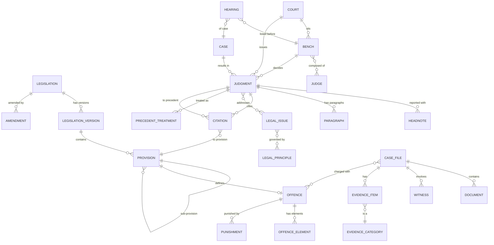

# 6. Database schema and entity-relationship design

Two layers:
- **Implemented now** (SQLite, in `data/`): what the scrapers fill today.
- **Target relational schema** (PostgreSQL): the full model the spec asks for. The implemented tables map onto it 1-to-1, so migrating is a straight copy.

## 6.1 Implemented (SQLite)

| Database | Table | Key columns |
|---|---|---|
| `court.db` | `courts` | code (SC, HC1…, SPC), name, kind |
| | `hearing_days` | court, bs_date, weekday, available |
| | `benches` | court, id, bs_date, bench_no, bench_type, judges |
| | `judges` | name, court, title |
| | `hearings` | court, bench_id, seq, case_no, case_type, subject, appellant, respondent, advocates, remarks, status, outcome, pdf_url, case_url |
| | `documents` | id, section, kind, title, principle, url, case_no, doc_date, bench, judges, pages, text_method |
| | `district_judgments` | court, case_no, subject, parties, reg/decision/auth dates, judge |
| `nkp.db` | `nkp` | id, decision_no, title, volume, year, month, issue, citation, decision_date, court, bench, judges, case_nos, parties, headnotes (JSON with para), counsel, relied, related_law, lower_courts, criminal, text_z |
| `statutes.db` | `acts` | id, title, year_bs, category, area, act_no, authenticated, commencement, pdf_url, sections_count, gaps |
| | `amendments` | act_id, seq, title, date_bs |
| | `sections` | act_id, seq, part, chapter, number, heading, body, amended_by |
| `links.db` | `citations` | src_type (nkp/scdoc), src_id, tgt_type (section/article/nkp/muluki_ain/other_act/old_constitution), act_id, section, tgt_id, label, raw, field, method='auto' |

## 6.2 Target schema (PostgreSQL)



### Key tables (abridged DDL)

```sql
CREATE TABLE legislation (id serial PRIMARY KEY, title_ne text, title_en text, act_no text,
  enacted_bs date_bs, commencement_bs date_bs, category text, source_url text);
CREATE TABLE legislation_version (id serial PRIMARY KEY, legislation_id int REFERENCES legislation,
  valid_from_bs date_bs, valid_to_bs date_bs, source text, source_url text, consolidated boolean);
CREATE TABLE amendment (id serial PRIMARY KEY, legislation_id int REFERENCES legislation,
  amending_act text, date_bs date_bs, gazette_ref text);
CREATE TABLE provision (id serial PRIMARY KEY, version_id int REFERENCES legislation_version,
  parent_id int REFERENCES provision, kind text CHECK (kind IN ('भाग','परिच्छेद','दफा','उपदफा','खण्ड','धारा')),
  number text, heading text, body text, amended_marker text);
CREATE TABLE offence (id serial PRIMARY KEY, provision_id int REFERENCES provision, name_ne text, name_en text);
CREATE TABLE offence_element (id serial PRIMARY KEY, offence_id int REFERENCES offence, element text,
  source text CHECK (source IN ('statute','precedent','lawyer')), verified_by text);
CREATE TABLE punishment (id serial PRIMARY KEY, offence_id int REFERENCES offence, prison_min text,
  prison_max text, fine text, text text);
CREATE TABLE judge (id serial PRIMARY KEY, name_ne text UNIQUE, title text);
CREATE TABLE court (id serial PRIMARY KEY, code text UNIQUE, name text, level text);
CREATE TABLE judgment (id serial PRIMARY KEY, court_id int REFERENCES court, bench_type text,
  case_nos text[], decision_date_bs date_bs, title text, nkp_citation text, decision_no int,
  full_text text, source_url text, pdf_url text, text_method text);
CREATE TABLE judgment_judge (judgment_id int REFERENCES judgment, judge_id int REFERENCES judge, role text);
CREATE TABLE headnote (id serial PRIMARY KEY, judgment_id int REFERENCES judgment, text text, paragraph text);
CREATE TABLE citation (id serial PRIMARY KEY, from_judgment int REFERENCES judgment,
  to_provision int REFERENCES provision, to_judgment int REFERENCES judgment, raw text,
  method text CHECK (method IN ('auto','lawyer')), verified_by text);
CREATE TABLE precedent_treatment (id serial PRIMARY KEY, judgment_id int REFERENCES judgment,
  later_judgment int REFERENCES judgment, treatment text CHECK (treatment IN
  ('followed','distinguished','modified','overruled','doubted')), paragraph text, verified_by text NOT NULL);
-- private, local-only
CREATE TABLE case_file (id serial PRIMARY KEY, title text, client_ref text, offence_date_bs date_bs);
CREATE TABLE document (id serial PRIMARY KEY, case_file_id int REFERENCES case_file, kind text, text text, file_path text);
CREATE TABLE evidence_item (id serial PRIMARY KEY, case_file_id int REFERENCES case_file, category text,
  description text, for_prosecution text, for_defence text, weakness text);
CREATE TABLE witness (id serial PRIMARY KEY, case_file_id int REFERENCES case_file, name text, role text, statement_doc int REFERENCES document);
```

### "Which law applied on the date of the offence?" (spec §5)
`legislation_version.valid_from_bs / valid_to_bs` answers it with one query. Today the Law Commission
publishes only the current consolidated text, so the implemented system has one version per act. It
flags amendments dated after the offence date, and the sections whose amendment markers name them.
Older versions are added as `legislation_version` rows when the Gazette or the original acts become
reachable (roadmap).

### Every provision ↔ precedents, every precedent ↔ provisions/issues
Implemented through `citations` (auto) today. The target `citation.method` / `verified_by`
columns separate machine-detected links from lawyer-verified ones. `legal_issue` / `legal_principle` are
populated from NKP headnotes (as published) and lawyer annotations, never generated.
